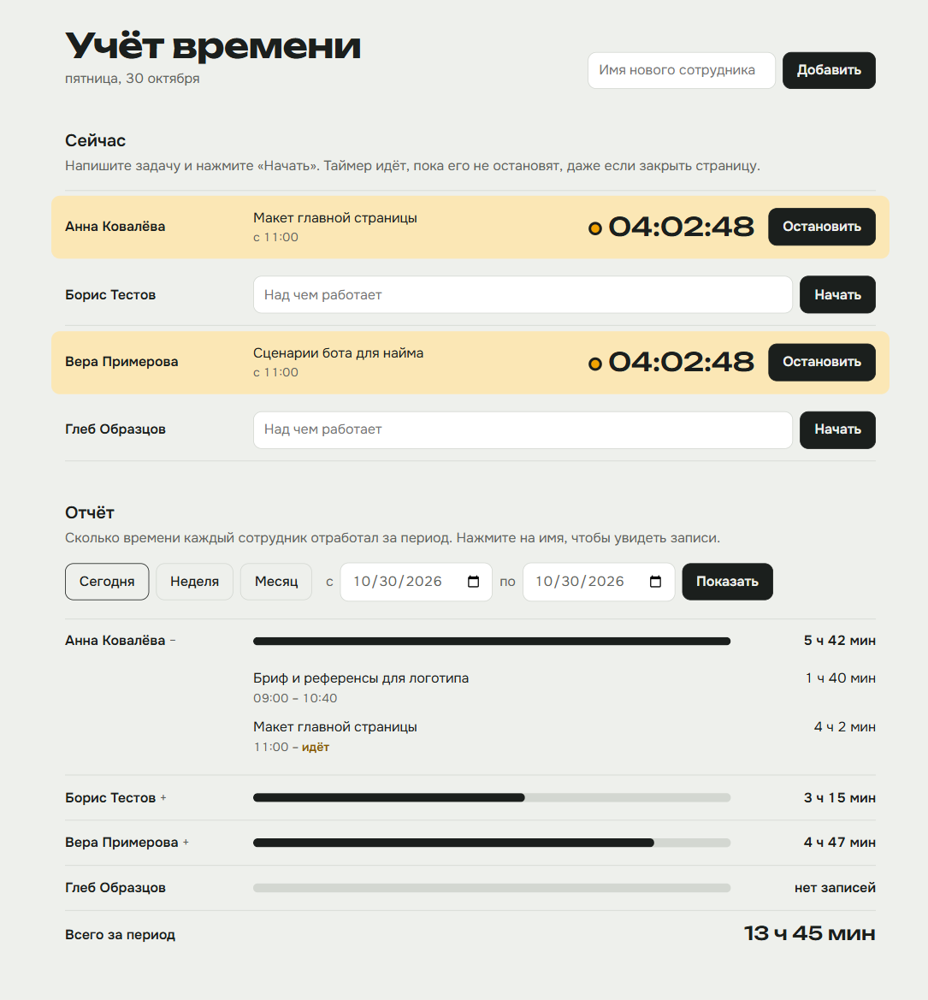

# Учёт рабочего времени

Веб-приложение для небольшой команды. Можно добавлять сотрудников, запускать и останавливать таймер с описанием задачи и смотреть, сколько каждый отработал за период. Данные хранятся в SQLite и не пропадают после перезапуска.



**Стек.** .NET 10, ASP.NET Core Minimal API, EF Core и SQLite. Интерфейс сделан одной HTML-страницей на чистом JS, без сборки. Тесты на xUnit, для проверки API используется WebApplicationFactory.

Время работы: _заполнить_.

## Запуск

Нужен [.NET 10 SDK](https://dotnet.microsoft.com/download/dotnet/10.0).

```bash
dotnet run --project src/TimeTracker --launch-profile http
```

Откройте http://localhost:5197. При первом запуске создаётся файл базы `src/TimeTracker/timetracker.db`, миграции применяются сами.

Тесты:

```bash
dotnet test
```

## Что умеет

- Добавлять сотрудников.
- Запускать таймер с описанием задачи и останавливать его. На странице тикает время, а сам таймер продолжает идти и после закрытия страницы, потому что он хранится на сервере.
- Запускать только один таймер на сотрудника. Если нажать старт повторно, API вернёт 409, а запись останется та, что была.
- Показывать отчёт за период: итог по каждому сотруднику и список его записей. Есть быстрый выбор «сегодня», «неделя», «месяц».
  - Если запись переходит через границу периода, в отчёт попадает только её часть внутри периода.
  - Запущенный таймер считается до текущего момента.
  - Сотрудники без записей показываются с нулём, так что пустой отчёт выглядит нормально.

## Устройство

```
src/TimeTracker/
  Domain/            модель и правила, ничего не знает про HTTP и базу
    Employee.cs        StartTimer / StopTimer, правило «один запущенный таймер»
    TimeEntry.cs       запись времени, нельзя остановить раньше старта
    TimePeriod.cs      период [from, to): сколько из записи попало в период
  Features/          по папке на фичу, в каждом файле эндпоинт целиком
    Employees/         AddEmployee, ListEmployees
    Timer/             StartTimer, StopTimer
    Reports/           GetReport
  Data/              AppDb (EF Core) и миграции
  wwwroot/           index.html
  Program.cs         регистрация сервисов и эндпоинтов
tests/TimeTracker.Tests/
  Domain/            тесты правил: без сервера и базы, миллисекунды
  Api/               сквозные сценарии через HTTP на настоящей SQLite
```

Эндпоинт делает три вещи: загружает модель, вызывает её метод и сохраняет результат. Правила живут в `Domain`. Если правило нарушено, модель бросает `DomainException`. Один фильтр на группе `/api` превращает это исключение в ответ 400 или 409, так что повторяющихся `if` в эндпоинтах нет.

Репозиториев и MediatR в проекте нет. `DbContext` уже работает как единица работы, и ещё один слой поверх него для пяти эндпоинтов только добавил бы кода.

**Время.** Всё время хранится в UTC. Границы дней для отчёта считает браузер в своём часовом поясе. Сервер берёт текущее время из `TimeProvider`, а в тестах его заменяют ручные часы, поэтому тесты не ждут настоящих минут.

### Как добавить фичу

Пример: редактирование описания записи.

1. В модель добавить метод `TimeEntry.Rename(string task)` с той же проверкой текста, что и при создании. Написать на него тест в `tests/.../Domain`.
2. Создать `Features/Entries/RenameEntry.cs` с методом `Map`: загрузить запись, вызвать `Rename`, сохранить. Подключить в `Program.cs` одной строкой.
3. Если меняется схема: `dotnet ef migrations add <Name> --project src/TimeTracker -o Data/Migrations`. Инструмент `dotnet-ef` прописан в `dotnet-tools.json`, его ставит `dotnet tool restore`.

## API

| Метод | Путь | |
|---|---|---|
| GET | `/api/employees` | сотрудники и их запущенный таймер |
| POST | `/api/employees` | `{ "name": "..." }` |
| POST | `/api/employees/{id}/timer/start` | `{ "task": "..." }`, 409 если таймер уже запущен |
| POST | `/api/employees/{id}/timer/stop` | 409 если таймер не запущен |
| GET | `/api/report?from=...&to=...` | период `[from, to)` в ISO 8601 |

## ИИ-инструменты

**Claude Code** (CLI), модель **Claude Opus 5.5**. С его помощью написаны код, тесты, интерфейс и черновик этого README.

**Как работал.** Сначала разобрал задание и выписал граничные случаи. Потом сделал быструю первую версию с тестами. Затем остановился, обсудил структуру и переделал проект под модель и фичи. На каждом шаге читал, что сгенерировано. В спорных местах проверял, что тест действительно ловит ошибку: убирал исправление и смотрел, как тест падает. Этапы видны в истории коммитов.

**Примеры запросов:**

> Вот тестовое задание [текст]. Разбери, что они хотят проверить, кроме явных пунктов. Какие граничные случаи тут есть?

> Что будет, если два запроса на старт таймера придут одновременно? Проверка через AnyAsync перед вставкой это не закрывает, нужна защита на уровне базы.

> Убери из кода конвертер UTC и уникальный индекс по очереди и прогони тесты. Хочу видеть, что тесты на них реально падают.

> Давай не делать свалку в Program.cs. Какую структуру посоветуешь, чтобы было расширяемо, но без лишних слоёв ради пяти эндпоинтов?

> Сделай интерфейс поприличнее: живой таймер у тех, кто сейчас работает, отчёт с быстрым выбором периода. Проверь вёрстку на телефоне.

## Ошибки, которые нашёл и исправил

**1. Двойной старт таймера при гонке.**
- **Проблема.** Проверка «уже запущен?» в модели не спасает, если два запроса пришли одновременно. Оба загружают сотрудника без запущенного таймера, и оба создают запись.
- **Исправление.** Частичный уникальный индекс `UNIQUE (EmployeeId) WHERE EndedAt IS NULL` в `Data/AppDb.cs`. Второй запрос получает ошибку от базы, а `StartTimer` превращает её в 409.
- **Проверка.** Тест `Concurrent_starts_create_only_one_entry` шлёт 10 параллельных стартов. Без индекса он стабильно падает.

**2. Время сдвигалось на часовой пояс.**
- **Проблема.** SQLite не хранит `DateTimeKind`. EF читает время обратно как `Unspecified`, в JSON оно уходит без `Z`, и браузер принимает UTC за локальное время. В Бишкеке таймер, запущенный в 15:00, показывался бы как 09:00.
- **Исправление.** Конвертер в `AppDb.ConfigureConventions`.
- **Проверка.** Тест `Times_are_returned_as_utc` без конвертера падает.

**3. Запись через полночь целиком попадала в один день.**
- **Проблема.** Фильтр по дате старта отдавал всю запись с 23:00 до 01:00 одному дню, а следующему ничего.
- **Исправление.** Теперь берутся все записи, которые пересекают период, а длительность обрезается в `TimePeriod.Overlap`.
- **Проверка.** Тесты `Entry_crossing_end_of_period_is_clipped` и `Entry_crossing_period_border_is_clipped`.

**4. «По» в отчёте не включало последний день.**
- **Проблема.** Запрос с `to = 30.10 00:00` не захватывает сам день 30.10.
- **Исправление.** API работает с полуоткрытым интервалом `[from, to)`, а страница прибавляет к дате «по» один день.

**5. На телефоне имя сотрудника рвалось по буквам.**
- **Проблема.** У запущенного таймера колонка с часами забирала всю ширину строки, и имя переносилось по буквам.
- **Исправление.** Поймал на скриншоте ширины 390px и перестроил строку для мобильной ширины.

## Тесты

29 тестов.

**`Domain/` — правила модели:**
- двойной старт;
- старт после стопа;
- стоп без старта и стоп раньше старта;
- пустые имя и задача, обрезка пробелов;
- подсчёт времени за период: запись внутри периода, на границе, запущенная, вне периода.

**`Api/` — сквозные сценарии.** Каждый тест поднимает приложение на отдельном временном файле SQLite:
- полный цикл;
- повторный старт и 10 одновременных стартов;
- пустой отчёт без сотрудников и пустой отчёт за период без записей;
- запущенный таймер в отчёте;
- запись через границу периода;
- данные после перезапуска приложения;
- время в ответах с `Z`;
- валидация, неизвестный сотрудник, перевёрнутый период.

## Чего нет

- Авторизации и ролей: по заданию не нужны.
- Редактирования и удаления записей.
- Экспорта отчёта.

Все данные в тестах и на скриншоте выдуманные.
